# declaude

A Claude Code and Codex skill for plain English, research exposition in the author's voice, and mathematical proofs with explicit displayed steps.

It removes rhetorical repetition and unnecessary abstractions while preserving facts, logical force, uncertainty, permissions, and scientific qualifications. It also supports drafting connected explanations rather than merely shortening text.

## Latest economical cross-model check

On the same three selected development cases, **v9 beats v4 on Astra high, splits on Sol low, and has a small net advantage on Sonnet high**. Both v4 and v9 help relative to no skill on this set, but proof gains should not be confused with a uniform prose improvement. These are two argument cases and one proof, with one blind Sol-high judge, not fresh OOS validation or a complete model/effort benchmark.

Each cell is win rate minus loss rate in **percentage points**, with ties contributing zero and **n=3**. Exact win/tie/loss counts and all case-level results are in the [report](evals/results/prose-repair/v9-cross-model/report.md).

| Generator / effort | v9 vs no skill | v4 vs no skill | v9 vs v4 |
|---|---:|---:|---:|
| Astra high | +66.7 | +33.3 | +100.0 |
| Sol low | +33.3 | +66.7 | +0.0 |
| Sonnet high | +100.0 | +100.0 | +33.3 |

The argument-only results are less uniform: Astra v9 beats v4 twice; Sol and Sonnet each have one win and one loss. On the proof, v9 beats v4 for Astra and Sonnet and ties for Sol. **Sonnet's two wins over v4 are fidelity decisions**, including an incorrect dependence assertion in its saved proof, rather than evidence that its prose is consistently better. The [interpretation](evals/results/prose-repair/v9-cross-model/interpretation.md) explains the actual passages and why v4's broader Claude evidence still matters. No installation or skill files were changed; packaged and installed remain v4.

This extension used **six writing calls and three batched judge calls**, with **183,559 reported tokens**, including cached input. It reused twelve no-skill/v4 drafts, completed Astra comparisons, and direct v4/no-skill grades. The rubric, author context, skill bundle and cases were frozen; no automatic retries or extra order audits were run. The hard limit was nine calls. Token counts are not account quota or billing.

Both fresh holdouts remain sealed/unrun. There is still no matched long-horizon result. The compact heatmaps below show earlier broader experiments and were not replaced with tiny-sample headline charts.

[Full cross-model results](evals/results/prose-repair/v9-cross-model/report.md) · [Interpretation and limitations](evals/results/prose-repair/v9-cross-model/interpretation.md) · [Frozen plan](evals/results/prose-repair/v9-cross-model/plan.json) · [Earlier Astra-only check](evals/results/prose-repair/v9-small/report.md).

## Codex prose repair: partial improvement, not promoted

**V8-dev improves nonproof writing over v4, but does not resolve Astra-high argument writing and loses some proof-exposition comparisons. Packaged and installed release remains v4.** The candidate separates argument development from compression, preserves useful explanatory steps, and keeps the proof and research-voice reference files byte-for-byte unchanged.

Both development phases are complete: 20 tuning cases followed by 20 different development cases with the candidate unchanged, across Astra medium/high, Sol low, and Luna medium. Both use the **same frozen author-specific judges**, Astra high and Sol high. No Claude calls were made. These are previously used development tasks, not fresh-test evidence.

Scores are win rate minus loss rate in percentage points; ties contribute zero. Intervals are 95% case-bootstrap intervals.

| Phase and scope | v8 vs no skill, pp [95% case CI] | v8 vs v4, pp [95% case CI] |
|---|---:|---:|
| Tuning: nonproof (16 cases) | +12.5 [+0.8, +24.2] | +24.2 [+10.2, +39.1] |
| Tuning: argument (4 cases) | +18.8 [+6.2, +25.0] | +40.6 [+18.8, +62.5] |
| Tuning: proof (4 cases) | +53.1 [+31.2, +78.1] | +6.2 [−15.6, +21.9] |
| Development check: nonproof (16 cases) | +9.4 [−2.3, +20.3] | +20.3 [+1.6, +38.3] |
| Development check: argument (4 cases) | +6.2 [−21.9, +31.2] | +12.5 [−21.9, +40.6] |
| Development check: proof (4 cases) | +81.2 [+62.5, +100.0] | −15.6 [−31.2, −3.1] |

**Astra high needs separate attention.** Its argument score against no skill is −12.5 pp in both phases. In the development check that means one win, five ties and two losses across four cases and two judges, with a wide case interval [−75.0, +37.5]. It improves on v4's arguments (+25.0 pp in the check), but that is not evidence of beating no skill. Its check score across all nonproof categories is +12.5 pp [−15.6, +37.5], so the earlier negative result is not universal across prose. Other models also vary: Sol low's argument gain in tuning becomes a loss in the check.

The proof-task comparison against v4 has zero wins, 27 ties and five losses in the check. The inspected losses concern purpose and ordering of explanations, rather than mathematical errors. Unchanged reference files did not guarantee unchanged behavior under a different core prompt. This tradeoff, together with unresolved argument results and overediting of some controls, prevents promotion. [Actual examples and the remaining failures](evals/results/prose-repair/case-review.md) explain the decision.

The check's candidate/reference material-error flags are 3/10 against no skill and 4/8 against v4, all minor. These are counts of judgments, not independent errors, and different pairs can yield different flags for the same output. Judges agree on 130/160 primary pairs; reversed order preserves 46/64 audited verdicts, with two direct reversals. The two phases used 415 Codex calls including 15 malformed-judgment retries and 4,897,358 CLI-reported tokens. Accepted outputs were never regenerated for quality.

These tests evaluate single-turn, self-contained rewrites with explicit editing instructions. They do not replay the long manuscript revisions and successive corrections that motivated many original complaints. Mining Astra-high chats does not establish that this synthetic task format preserves the conditions behind those failures. A fresh holdout in the same format tests new passages, not that longer workflow.

The [fresh 30-case holdout](evals/large/fresh-holdout-20261019-manifest.json) remains private, unopened by the optimizer, and unrun. An independent review checked all cases, two were corrected privately, and the second review passed. It is backed up privately outside the temporary session files.

The heatmaps show four cases per category in each phase, with 16 cases in “All prose” (all nonproof categories, including controls). Each cell combines both judges; the “All” column also combines the four generators. Values are shown to one decimal place. Paired Tune/Check rows make the two development phases directly comparable; neither is OOS.

<picture>
  <source media="(prefers-color-scheme: dark)" srcset="evals/results/prose-repair/plots/v8-dev-categories-dark.svg">
  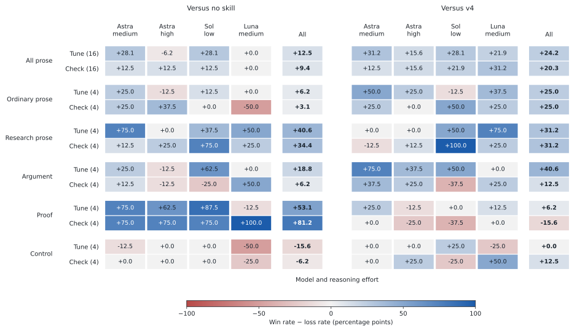
</picture>

<details>
<summary>Meaning, naturalness, progression, voice, and proof dimensions</summary>

<picture>
  <source media="(prefers-color-scheme: dark)" srcset="evals/results/prose-repair/plots/v8-dev-dimensions-dark.svg">
  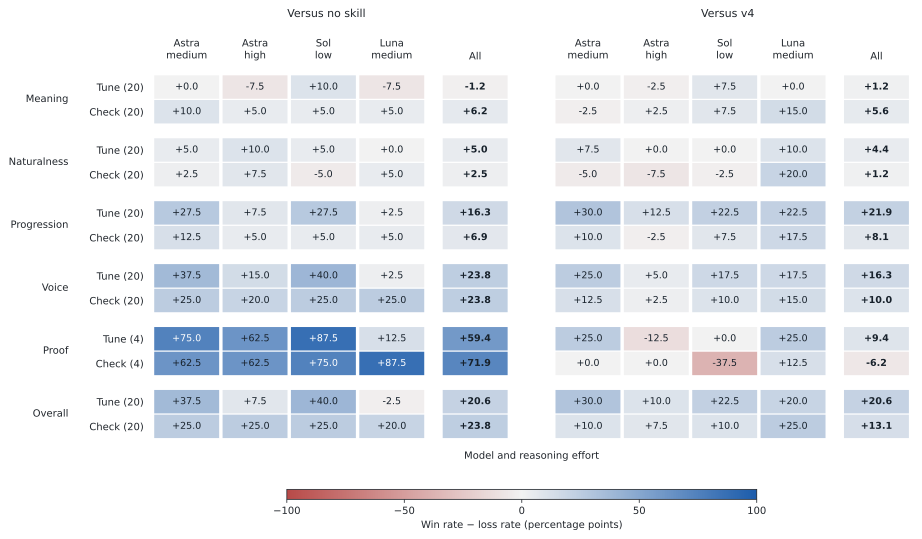
</picture>

</details>

[Tuning report](evals/results/prose-repair/v8-dev-tune/report.md) · [Development check](evals/results/prose-repair/v8-dev-validation/report.md) · [Release decision](evals/results/prose-repair/release-decision.json) · [Frozen protocol](evals/large/prose-repair-protocol.md) · [Tuning selection](evals/results/prose-repair/selection.json).

Reproduce the completed reports and charts without model calls:

```sh
python3 tools/prose_repair.py report --candidate v8-dev --subset tune --published
python3 tools/prose_repair.py report --candidate v8-dev --subset validation --published
MPLCONFIGDIR=/tmp/declaude-mpl .local/venv/bin/python tools/plot_prose_repair.py evals/results/prose-repair/v8-dev-tune evals/results/prose-repair/v8-dev-validation --out evals/results/prose-repair/plots
```

## Does it improve writing?

The [author-specific regrade](evals/results/context-regrade/report.md) finds clear gains on saved Claude outputs and on Codex proof exposition. **It does not establish a general improvement in Codex prose.** V4 and v5a have similar results, and the installed release remains v4.

The changed scores assess **unchanged writing under a new judging setup**; they are not evidence of a new skill version improving. On the same 400 development pairs, Astra's v5a score changes from +25.5 to +37.8 pp. The expanded headline also uses different case coverage. Relative gains over each model's own baseline do not rank their absolute writing quality, and the Claude–Codex difference has not been causally isolated.

Two blind Codex judges, Astra high and Sol high, graded the saved writing against the author's stated preferences: motivation before constructions, connected explanation, precise scope, preserved voice, and explicit displayed proof steps. There were **no new writing generations and no Claude calls**.

The table shows **win rate minus loss rate in percentage points**, with ties contributing zero. A larger number means a more favorable balance of judgments, not a percentage increase in writing quality. Development uses 40 cases; the original holdout supplies 27 cases with complete outputs across all ten generation configurations.

| Saved writing | v4 development | v4 held-out | v5a development | v5a held-out |
|---|---:|---:|---:|---:|
| All saved outputs | +38.8 | +33.1 | +38.0 | +32.6 |
| Saved Claude outputs | +57.7 | +46.0 | +57.5 | +44.1 |
| Saved Codex outputs | +10.3 | +13.9 | +8.7 | +15.3 |
| Codex, excluding proofs | -3.9 | +2.2 | -3.5 | +3.8 |

Across all configurations, held-out v4 scores **+33.1 pp [95% case-bootstrap CI +23.1, +43.0]**; v5a scores **+32.6 [+21.5, +43.9]**. The family and task breakdown changes the practical conclusion:

- **Codex proof tasks improve strongly:** both versions score +81.2 pp on four held-out proof cases. The gains reflect motivating the algebra and retaining explicit derivations, rather than just adding displays. This supports retaining the proof guidance, although four cases are a small sample.
- **Codex outside proofs is roughly neutral:** v4 scores +2.2 pp [−12.5, +16.3], and v5a +3.8 [−11.4, +17.9], on 23 held-out cases. Argument tasks remain negative (−21.9 and −25.0 pp), and ordinary prose is close to neutral. The broader Codex prose problem remains.
- **V5a does not show a clear advance over v4.** The small v6/v7 pilots are reported separately; their six outputs each do not justify promotion.

[Examples of improvements, losses, and a questionable judge interpretation](evals/results/context-regrade/case-review.md) accompany the scores. The earlier three-case holdout result and this 27-case result have different coverage. On the exact 30 held-out pairs judged by Astra in both runs, the old score changes from −10.0 to 0.0 pp, with wide intervals. The larger headline change cannot be attributed entirely to the new rubric.

The 2,706 primary judgments and 286 reversed-order checks are all complete. Judges agree on 81.1% of primary pairs; reversed order preserves 79.0% of audited verdicts, with 14 direct win/loss reversals. These are fallible model judgments against explicit preferences, not independent human labels. The holdout regrade is **retrospective**, and its incomplete, uneven category coverage limits generalization claims. Original grades remain available below.

### Installed v4 versus no skill

Rows show development (IS) and the retrospective held-out subset (OOS). Parentheses give distinct case counts. Columns name the models that generated the saved text; both new judges are Codex models. All panels use a zero-centered signed scale.

<picture>
  <source media="(prefers-color-scheme: dark)" srcset="evals/results/context-regrade/v4-vs-none/plots/pairwise-categories-dark.svg">
  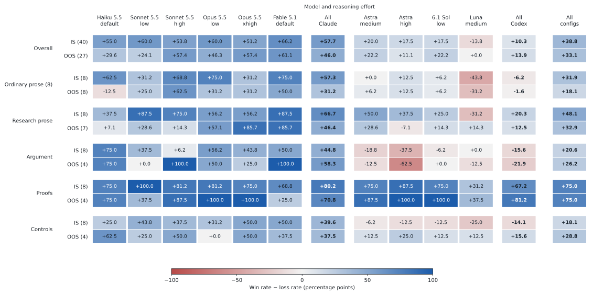
</picture>

### V5a versus no skill

<picture>
  <source media="(prefers-color-scheme: dark)" srcset="evals/results/context-regrade/v5a-vs-none/plots/pairwise-categories-dark.svg">
  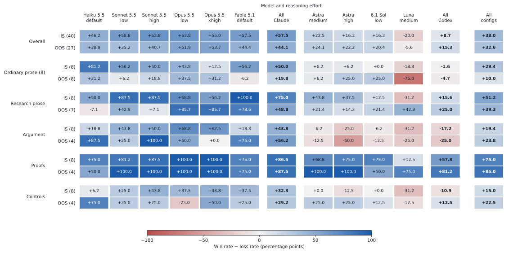
</picture>

<details>
<summary>Meaning, naturalness, progression, voice, and proof dimensions</summary>

### V4 dimensions

<picture>
  <source media="(prefers-color-scheme: dark)" srcset="evals/results/context-regrade/v4-vs-none/plots/pairwise-dimensions-dark.svg">
  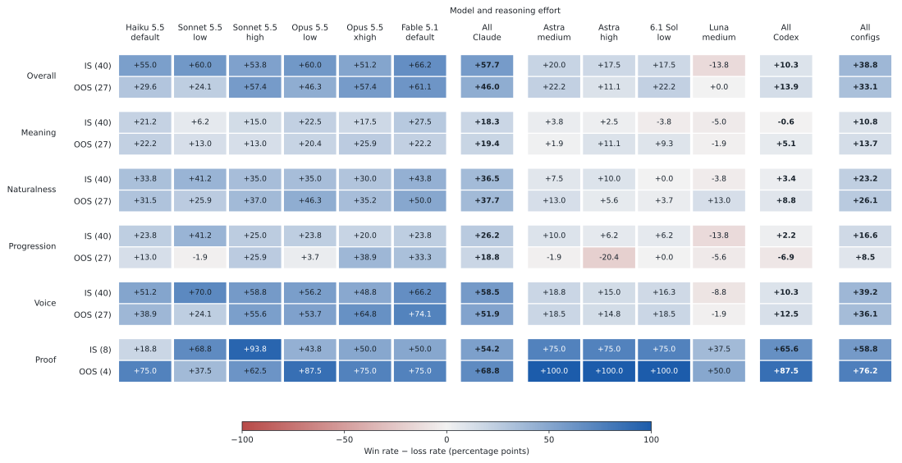
</picture>

### V5a dimensions

<picture>
  <source media="(prefers-color-scheme: dark)" srcset="evals/results/context-regrade/v5a-vs-none/plots/pairwise-dimensions-dark.svg">
  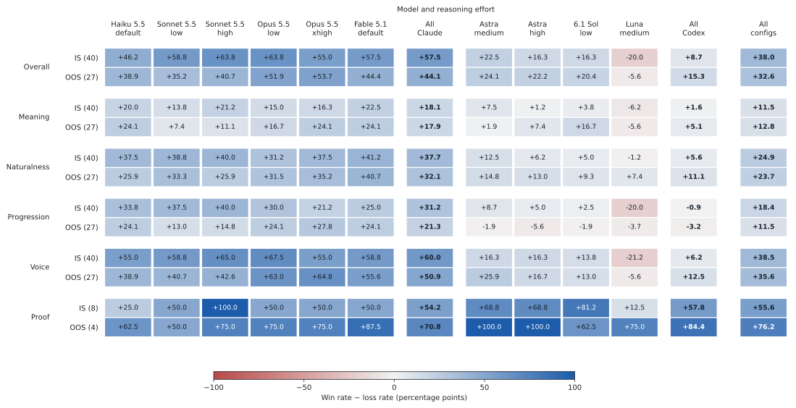
</picture>

</details>

[Full report and confidence intervals](evals/results/context-regrade/report.md) · [Frozen rubric](evals/results/context-regrade/rubric.txt) · [Coverage](evals/results/context-regrade/coverage.json) · [Judge checks](evals/results/context-regrade/judge-checks.json) · [Execution and recovery](evals/results/context-regrade/execution-notes.md) · [Usage](evals/results/context-regrade/usage.json).

Rebuild this report and its charts from the published evidence without model calls:

```sh
MPLCONFIGDIR=/tmp/declaude-mpl .local/venv/bin/python tools/report_context_regrade.py --published --plot
```

<details>
<summary>Historical results from the original grader and earlier benchmarks</summary>

These sections retain the earlier evaluation history. Their grading target and coverage differ from the author-specific regrade above.

## Small development repair

A [six-pair Codex-only pilot](evals/results/dev-repair-1/report.md) tested a revision aimed at document organization against saved v5a outputs. It used **12 calls and no Claude calls**: six outputs from Sol low/Luna medium and six blind judgments from Astra high. Result: **1 win / 3 ties / 2 losses, −16.7 percentage points**. Meaning tied in all six comparisons, and neither side had a material-error flag.

The tested repair is not promoted. A narrower [v6b-dev draft](evals/versions/v6b-dev/SKILL.md) is saved but **untested and not installed**. The packaged release remains v4. This is development work motivated by earlier test feedback, so the old holdout is no longer fresh evidence for these revisions. No new holdout runs were made.

## Larger benchmark: interim snapshot

The new 80-task, ten-configuration experiment is **paused and incomplete**. The [interim report](evals/results/large-interim/report.md) contains 2,012 of 2,400 writing outputs, 1,458 absolute scorecards, and 2,078 of 3,820 pairwise judgments, including order audits. No additional model calls were made to publish this snapshot.

| Split | Cases with complete pairwise coverage | V5a vs no skill (pp) | V5a vs v4 (pp) |
|---|---:|---:|---:|
| Development | 39/40 | +16.92 | +3.46 |
| Fresh holdout | 3/40 | -25.00 | +3.33 |

Net advantage is win rate minus loss rate in percentage points, with ties contributing zero. Both judge families and all ten configurations are represented for every included case. Win/tie/loss counts are in the linked report. **Three completed holdout cases cannot establish generalization.** They are an execution-order subset. Missing results are not counted as ties or zeros, and neither these results nor subsequent test results may be used to tune the selected revision.

[Exact outputs and grading evidence](evals/results/large-interim/report.md#files) · [Coverage](evals/results/large-interim/coverage.json) · [Development selection](evals/large/selection.json) · [Frozen protocol](evals/large/protocol.md).

V5a narrowly qualified under the original reserved-development selection rule, which remains recorded unchanged. The packaged and installed skill remains v4. Current repairs are separate development candidates; none has passed a release decision.

### Interim plots: v5a versus no skill

Rows show development (IS) and the completed portion of the fresh holdout (OOS). Parentheses give the number of distinct cases for that row, not model outputs or judge votes. NA means missing or not applicable. These are the same frozen intermediate results as the tables above.

<picture>
  <source media="(prefers-color-scheme: dark)" srcset="evals/results/large-interim/plots/v5a-vs-none/pairwise-categories-dark.svg">
  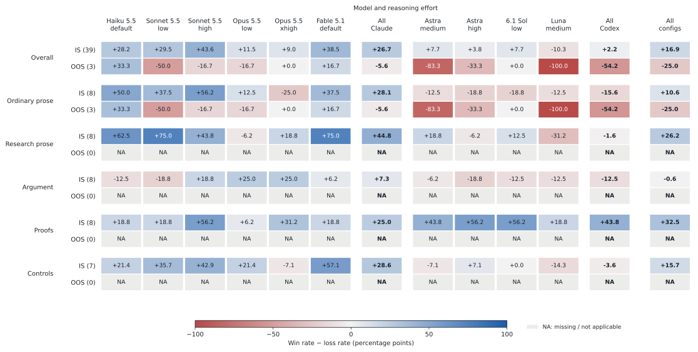
</picture>

The pairwise scale is centered at zero: positive percentage points favor v5a and negative values favor the reference. Ties contribute zero. This is a recentering of the same judgments, not a change in their ranking. All three completed holdout cases are ordinary prose, so the other holdout categories remain NA.

<picture>
  <source media="(prefers-color-scheme: dark)" srcset="evals/results/large-interim/plots/v5a-vs-none/assertions-dark.svg">
  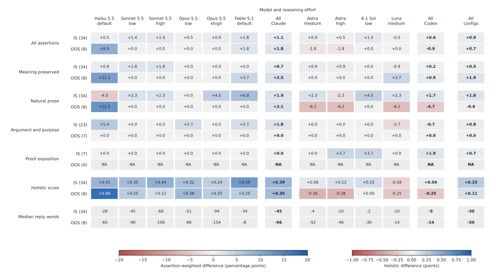
</picture>

Absolute grading is further ahead on some cases: these plots use 34 development and eight holdout cases with all three arms graded. The case subsets differ from the pairwise plots. Assertion changes are percentage points, holistic changes are score points, and reply length is descriptive.

<details>
<summary>Pairwise dimensions and v5a versus v4</summary>

### V5a versus no skill: writing dimensions

<picture>
  <source media="(prefers-color-scheme: dark)" srcset="evals/results/large-interim/plots/v5a-vs-none/pairwise-dimensions-dark.svg">
  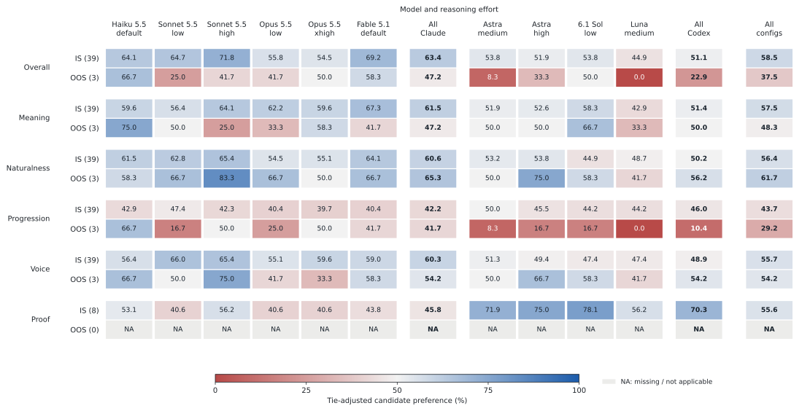
</picture>

### V5a versus v4

<picture>
  <source media="(prefers-color-scheme: dark)" srcset="evals/results/large-interim/plots/v5a-vs-v4/pairwise-categories-dark.svg">
  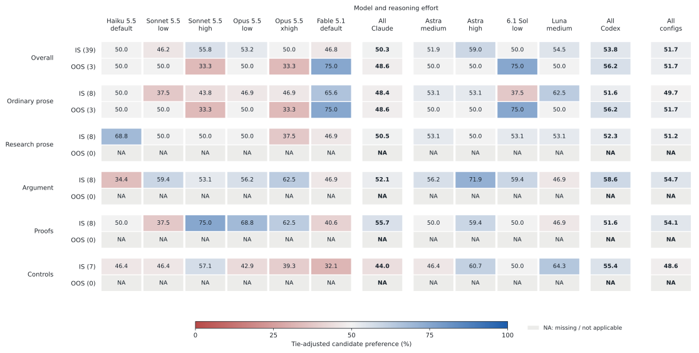
</picture>

<picture>
  <source media="(prefers-color-scheme: dark)" srcset="evals/results/large-interim/plots/v5a-vs-v4/pairwise-dimensions-dark.svg">
  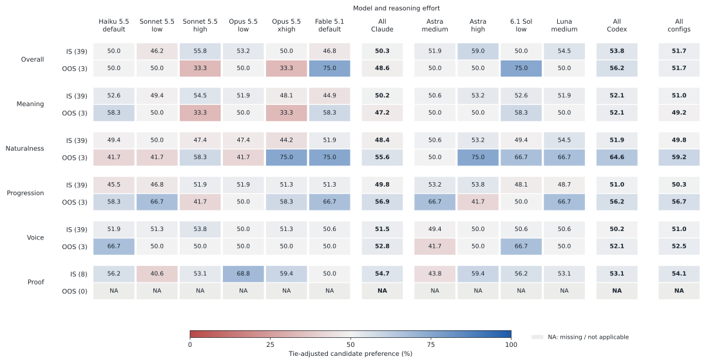
</picture>

<picture>
  <source media="(prefers-color-scheme: dark)" srcset="evals/results/large-interim/plots/v5a-vs-v4/assertions-dark.svg">
  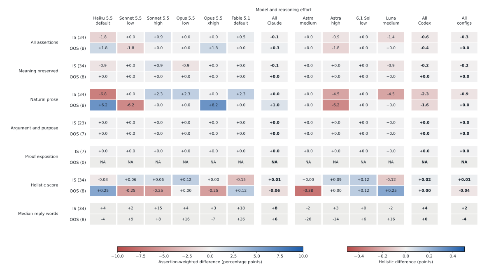
</picture>

</details>

<details>
<summary>Absolute levels: no skill and selected revision</summary>

<picture>
  <source media="(prefers-color-scheme: dark)" srcset="evals/results/large-interim/plots/v5a-vs-none/levels-none-dark.svg">
  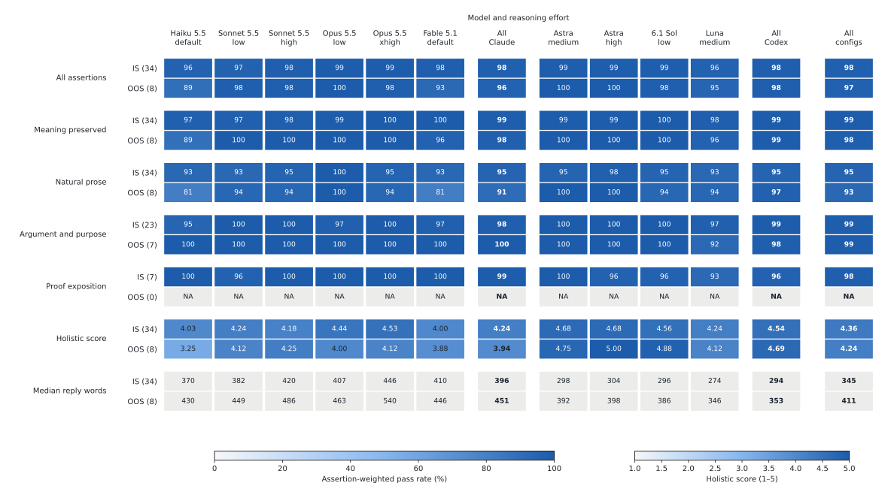
</picture>

<picture>
  <source media="(prefers-color-scheme: dark)" srcset="evals/results/large-interim/plots/v5a-vs-none/levels-skill-dark.svg">
  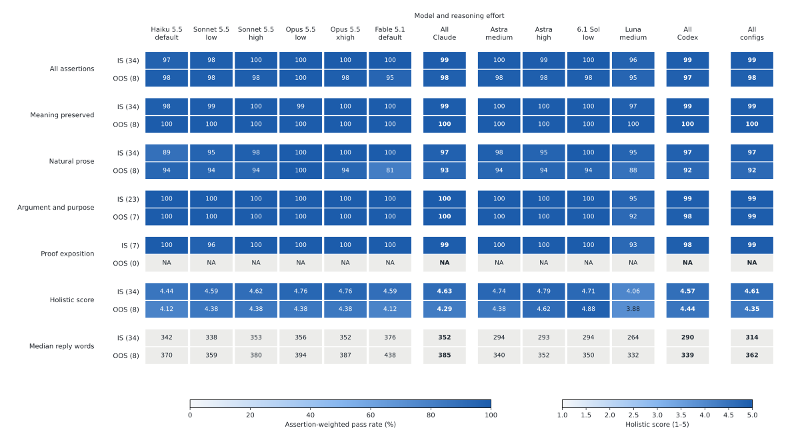
</picture>

</details>

Regenerate these plots from the published snapshot without model calls:

```sh
MPLCONFIGDIR=/tmp/declaude-mpl .local/venv/bin/python tools/plot_interim.py
```

<details>
<summary>Earlier 16-case benchmark and historical plots</summary>

## Earlier 16-case results

The final comparison covers **10 configurations and 480 outputs**: eight development cases and eight fresh held-out cases, each run with no skill, v3, and v4. V4 improves assertion passes over no skill on the fresh cases, but **does not establish an improvement over v3**. Its development advantage did not generalize clearly.

| Split | No skill: passes / holistic | v3: passes / holistic | v4: passes / holistic |
|---|---:|---:|---:|
| In sample: 8 development cases | 90.8% / 4.36 | 97.8% / 4.64 | 98.6% / 4.75 |
| Out of sample: 8 fresh cases | 95.9% / 4.55 | 98.8% / 4.74 | 98.5% / 4.72 |

Holistic scores are out of 5. On the fresh set, v4 versus no skill is **+2.68 percentage points** in assertions (95% paired case-bootstrap interval **+0.48 to +4.77**) and **+0.175 holistic points** (**−0.075 to +0.425**). Against v3, v4 is **−0.24 pp** (**−1.58 to +0.89**) and **−0.0125 holistic points** (**−0.1375 to +0.0875**). These are small synthetic tests with substantial ceiling effects, not evidence of universal improvement. Of the 50 fresh-test assertion cells across individual configurations and five metrics, 33 show zero difference; 30 of those have both conditions at 100%. The 480 outputs cover only 16 distinct tasks, eight of them fresh. This test is too small and easy for detailed model-by-category conclusions.

| Model | Effort settings tested |
|---|---|
| Claude Haiku 5.5 | default |
| Claude Sonnet 5.5 | low, high |
| Claude Opus 5.5 | low, xhigh |
| Claude Fable 5.1 | default |
| GPT-6 Astra | medium, high |
| GPT-6.1 Sol | low |
| GPT-6 Luna | medium |

### V4 versus no skill

<picture>
  <source media="(prefers-color-scheme: dark)" srcset="evals/results/final-v4/assertions-dark.svg">
  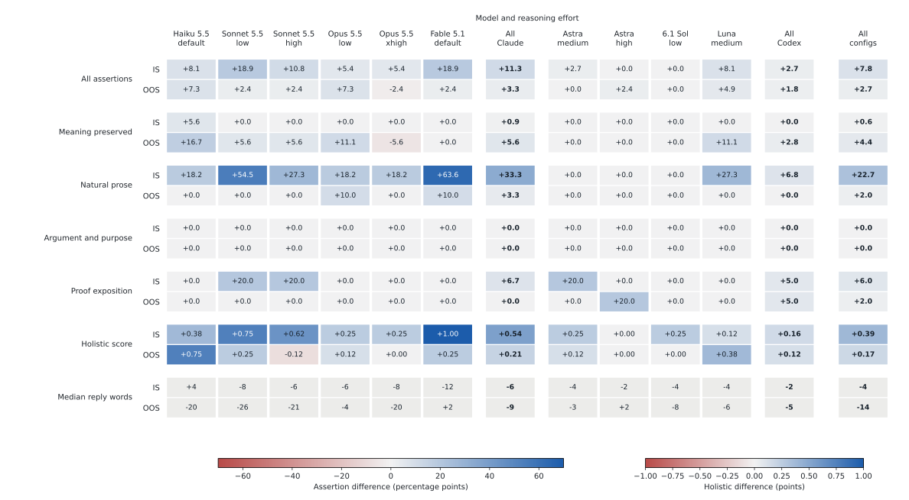
</picture>

IS means development; OOS means the fresh held-out set. Cells show differences, in percentage points for assertions, score points for holistic grades, and words for median length. Gray length cells are descriptive: there are no length-threshold assertions. Model-family and overall aggregates weight configurations equally within each pool. The proof group has only two cases per split. Exact denominators, case counts, and intervals are in [groups_by_config.json](evals/results/final-v4/groups_by_config.json).

### V4 versus v3

<picture>
  <source media="(prefers-color-scheme: dark)" srcset="evals/results/v4-vs-v3/assertions-dark.svg">
  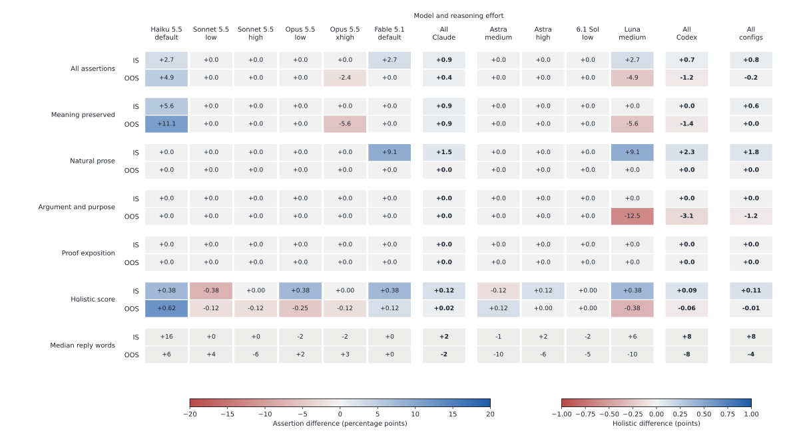
</picture>

The two figures use separate color ranges; read the legends. The modest average hides differences across configurations. On fresh cases, Haiku's holistic score rises from 4.12 to 4.75 with v4 versus v3, while Luna falls from 4.38 to 4.00. Eight cases and one response per condition do not support a stable model ranking.

<details>
<summary>Absolute rates and scores</summary>

No skill:

<picture>
  <source media="(prefers-color-scheme: dark)" srcset="evals/results/final-v4/levels-none-dark.svg">
  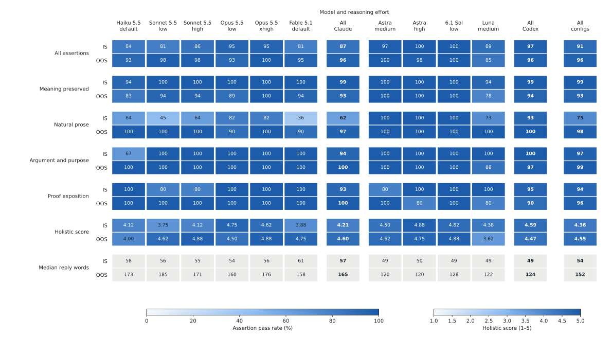
</picture>

V4:

<picture>
  <source media="(prefers-color-scheme: dark)" srcset="evals/results/final-v4/levels-skill-dark.svg">
  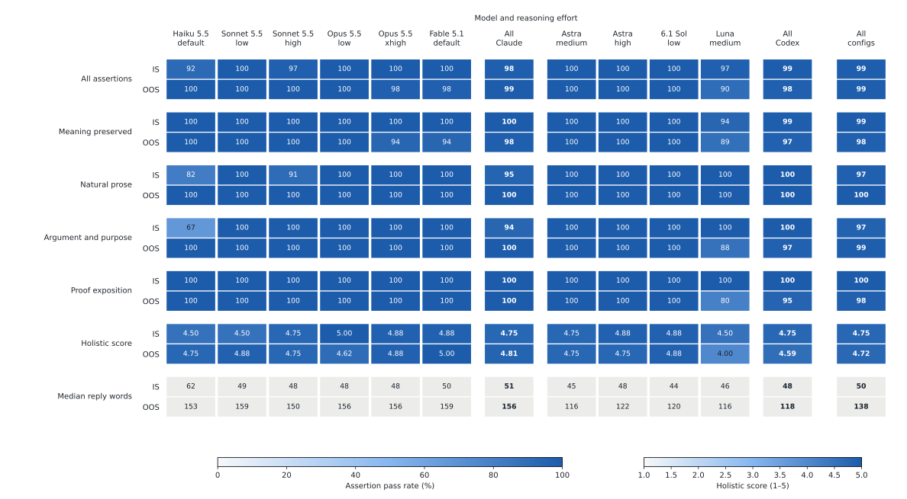
</picture>

</details>

[Full v4 versus no-skill report](evals/results/final-v4/report.md) · [V4 versus v3](evals/results/v4-vs-v3/report.md) · [V3 versus no skill, same grader](evals/results/v3-calibrated/report.md) · [Exact outputs and grades](evals/results/final-v4/observations.json)

## What changed, and what still fails

V4 adds a short procedure for reconstructing a passage from its meaning instead of paraphrasing each source sentence. It makes consolidation of repeated claims and motivation-before-construction more explicit. It was selected before the fresh test under a development rule requiring improved mean holistic score without a decrease in aggregate fidelity passes. The selection gain was small: 4.6375 → 4.725, with fidelity 98.33% → 98.89%. The final regrading is reported separately from those selection grades. V4 is the packaged version; its fresh-test tie with v3 is retained rather than advertised as a further generalization gain.

The grader was also revised. V2 distinguishes rhetorical packaging from factual content and mathematical validity from requested exposition. On ten fixed calibration cases, both graders matched all 22 expected assertion judgments. V1 matched 19/20 expected holistic bands; v2 matched 20/20, fixing one overpenalty for minor equation formatting. These reference judgments were assistant-authored, with four cases reserved for validation. This is limited calibration evidence, **not independent human validation**. [Calibration details](evals/results/grader-calibration/report.md).

The new grader still makes questionable judgments. It penalizes some outputs for omitting an explicitly requested arithmetic difference while retaining both percentages, but correctly avoids treating that as a material factual error. It also gives debatable penalties to a proof whose displayed equations already identify indicator expectations with probabilities and to a coherent introduction's motivation. The ratings remain unchanged. [Inspection and disagreements](evals/results/final-v4/failure-review.md).

A concrete remaining skill failure is Luna's interval-merging explanation: it omits the final output step, even though its example gives the right final intervals. This is an actual completeness issue, not just a forbidden-word check. Both the technical and personal-voice controls are retained in the benchmark.

## Method and limits

- Candidate tasks request actual edited text or proofs, not plans. The final set includes a three-paragraph introduction, an algorithm explanation, scientific qualifications, two mathematical proofs, and technical/personal-voice controls.
- The complete public skill and references are inlined. Private reading lists are excluded. Claude tools are disabled. Codex runs in a read-only temporary environment and is instructed not to use tools. Personal global instructions are isolated from candidate calls. This tests the effect of supplied guidance, not automatic discovery or full-manuscript retrieval.
- An isolated Opus 5.5 high-effort grader sees anonymous outputs in seeded random order, without model/condition identities or skill text. All final conditions use grader v2. Matched conditions stay in the same pool, with up to ten responses per call. The grader is from one of the model families being evaluated and may share its preferences.
- Four development cases were initially used for tuning and four for validation. Both subsets became selection data. V4 was then compared with v3 across all ten configurations. The fresh test author saw neither skill nor development cases. [Frozen candidate/test plan](evals/improvement-plan.json), [selection](evals/revision-selection.json), and [final matrix](evals/revision-matrix.json) record the sequence.
- Final grading was rerun in balanced three-condition pools. Development-selection grades remain separately published; no preferred repeated grade was chosen. Two schema-invalid grading batches were retried, preserving completed valid batches. All 480 outputs now have valid scorecards; no candidate output was regenerated based on its quality.
- Bootstrap intervals resample paired cases, not individual assertions or model outputs. They do not capture all generation and grader variability. There is one candidate response per condition and no independent human preference study. The fresh tasks have high baseline scores, so small differences should not be overinterpreted.
- Neither inspected test set is untouched for a future revision. No fresh-test outcome was used to change v4. A later improvement needs a new holdout.

### Earlier reference runs

The original three-configuration report is [archived](evals/results/initial-three-configs/report.md). Expanding frozen v3 to all ten configurations under the original grader produced **87.7% → 91.2%** passes and **3.89 → 4.26** holistic scores on the original held-out set, with a proof-detail regression. [Expanded v3 reference](evals/results/expanded-v3/report.md) · [Failures](evals/results/expanded-v3/failure-review.md).

That reference uses different held-out cases and the old grader. Its numbers must not be compared directly with the fresh set to claim that the skill or grader improved. The final v3/v4 comparison above holds cases and grader fixed.


</details>


</details>

## Install

```sh
git clone https://github.com/hetankevin/declaude.git
cd declaude
python3 install.py
```

The installer copies `skill/` into the current user's Claude and Codex skill directories and backs up existing copies. It does not change global instructions or hooks. Invoke `/declaude` in Claude Code or `$declaude` in Codex. Normal skill discovery is enabled; this is not an always-on injection.

A private reading list can be placed in `skill/references/papers.local.md` and installed with `python3 install.py --personal`. That file is ignored by Git. The public skill works without it using writing samples and project notes supplied with the task.

## Reproduce

Rebuild reports and charts from published observations without model calls:

```sh
python3 -m venv .local/venv
.local/venv/bin/pip install -r requirements.txt
.local/venv/bin/python tools/report.py \
  --observations evals/results/final-v4/observations.json \
  --cases evals/development.json evals/heldout2.json \
  --matrix evals/revision-matrix.json \
  --reference none --selected v4 --out .local/reproduced --plot
```

Use `--reference v3 --selected v4` for the direct revision comparison, or `--reference none --selected v3` for the incumbent baseline comparison.

With authenticated, compatible Claude and Codex CLIs, generate a fresh comparison. These calls consume the accounts' available capacity:

```sh
for split in development heldout2; do
  python3 tools/bench.py run --cases evals/$split.json \
    --arms none,v3,v4 --skills v3=evals/versions/v3,v4=skill \
    --out .local/rerun
  python3 tools/bench.py grade --cases evals/$split.json \
    --grader-version v2 --out .local/rerun
done
.local/venv/bin/python tools/report.py --runs .local/rerun \
  --cases evals/development.json evals/heldout2.json \
  --matrix evals/revision-matrix.json \
  --reference none --selected v4 --out .local/rerun-report --plot
```

The runner rejects ambiguous multi-version labeling. Task, skill, model, and effort metadata are checked before cached results are reused; reports check the full matrix. Earlier skill snapshots are in `evals/versions/`, and grader prompts are in `evals/graders/`. To reproduce the expanded original reference, use `evals/heldout.json`, v3, and `--grader-version v1`.

## Sources and scope

The skill incorporates a user-supplied translation specification, recurring directions in research-workspace writing notes, direct author corrections about proofs and prose, and structural editing patterns from an existing humanizer skill. The public package contains generalized directions and synthetic examples. Source conversations, personal workspace paths, and private reading lists are not included.

See [translation](skill/references/translation.md), [research writing](skill/references/paper-voice.md), and [proof guidance](skill/references/proofs.md). This is an editing tool, not an AI-authorship detector or a promise to evade one.
