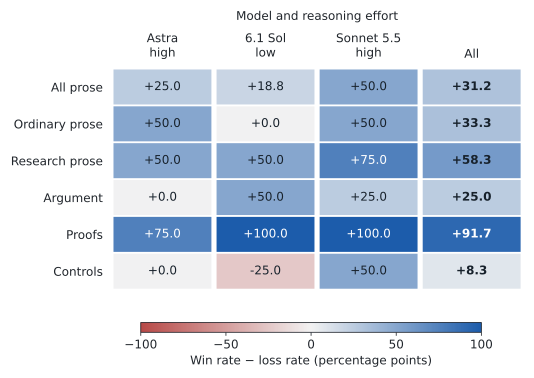
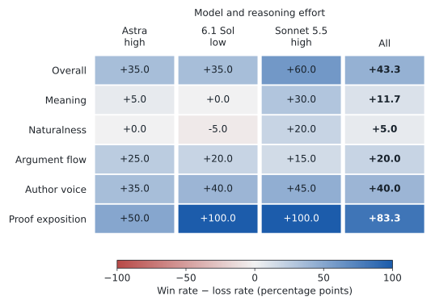
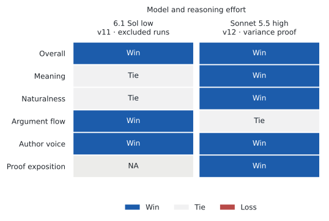

# declaude

A Claude Code and Codex skill for plain English, research exposition in the author's voice, and mathematical proofs with explicit displayed steps. It removes rhetorical repetition and unnecessary abstractions while preserving meaning, uncertainty, scientific qualifications, and the author's voice.

## Results against no skill

The broad evaluation finds gains on saved Claude writing and on Codex proof exposition. **Codex prose outside proofs is roughly neutral overall, with argument writing still a weakness.** The installed release is v4. Later development repairs are shown separately below, because they have much smaller coverage.

The heatmaps follow the same layout throughout: columns identify the writing model and reasoning effort; paired rows compare development (IS) with the retrospective held-out subset (OOS). Blue means improvement, red means regression, and zero means wins and losses balance. Values are **win rate minus loss rate in percentage points**; ties contribute zero. Parentheses show distinct case counts. All displayed comparisons are against no skill.

<picture>
  <source media="(prefers-color-scheme: dark)" srcset="evals/results/context-regrade/v4-vs-none/plots/pairwise-categories-dark.svg">
  
</picture>

On the 27-case retrospective held-out subset, the overall balance is **+33.1 pp** (95% case-bootstrap interval +23.1 to +43.0). Claude outputs show +46.0 pp and Codex +13.9 pp. Codex proof tasks account for much of its gain: +81.2 pp on four proof cases, compared with +2.2 pp [−12.5, +16.3] on the 23 other cases. These are improvements relative to each model's own baseline, not an absolute ranking of the models' writing.

The dimensions distinguish preserving meaning from improving the way an argument or proof reads:

<picture>
  <source media="(prefers-color-scheme: dark)" srcset="evals/results/context-regrade/v4-vs-none/plots/pairwise-dimensions-dark.svg">
  
</picture>

**How these results were measured.** Two blind Codex judges, Astra high and Sol high, regraded saved outputs against the author's stated writing preferences. Development has 40 cases and the retrospective holdout has 27 cases complete across ten generation configurations. This regrade changed the judging setup, not the writing. The evaluation's 2,706 primary judgments and 286 reversed-order checks cover both recorded skill versions. Judges agree on 81.1% of primary pairs, and reversed order preserves 79.0% of audited verdicts. These are fallible model judgments, not independent human labels. Uneven category coverage and retrospective grading limit generalization claims; the two newer fresh holdouts remain untouched.

[Full report and confidence intervals](evals/results/context-regrade/report.md) · [Case-level examples](evals/results/context-regrade/case-review.md) · [Rubric](evals/results/context-regrade/rubric.txt) · [Coverage](evals/results/context-regrade/coverage.json) · [Judge checks](evals/results/context-regrade/judge-checks.json).

## Development checks against no skill

These are known development cases, **not additional OOS evidence**. Their results are not pooled into the broad benchmark above. Version-to-version comparisons remain in development records rather than the displayed figures.

### Restored v9: 20 cases per model

This completed check uses the same 20 previously inspected cases on Astra high, Sol low and Sonnet high: four each of ordinary prose, research, argument, proof and controls. The judge is the frozen author-specific Sol-high judge. Each model improves overall against no skill, but the category breakdown matters: Astra's argument score is zero. “All prose” excludes proofs and includes controls.

<picture>
  <source media="(prefers-color-scheme: dark)" srcset="docs/img/restored-dev-categories-dark.svg">
  
</picture>

<details>
<summary>Development results by writing dimension</summary>

<picture>
  <source media="(prefers-color-scheme: dark)" srcset="docs/img/restored-dev-dimensions-dark.svg">
  
</picture>

</details>

This check produced 60 drafts and reused saved baselines. Of 120 judgments across its two recorded comparator arms, 117 passed original validation, one required a source-verified capitalization correction, and two had inadmissible optional source quotations removed with raw answers and preferences retained. Required evidence stayed strict. The [development report](evals/results/prose-repair/v9-restored-20/report.md) records the full method, uncertainty and evidence qualifications.

### Latest focused repairs: one case per model

The Sol draft reduces repetition in an excluded-runs argument. The Sonnet draft removes a false dependence assertion while retaining the conditional-expectation argument. Both beat their saved no-skill drafts overall and have no candidate material-error flags. Each cell below is **one judgment**, so it shows Win/Tie/Loss rather than an aggregate percentage.

<picture>
  <source media="(prefers-color-scheme: dark)" srcset="docs/img/focused-dev-dark.svg">
  
</picture>

These columns use different cases and candidate versions: Sol was tested with v11; Sonnet with v12, which adds only a proof-reference safeguard to the same core. Proof exposition is not applicable to Sol's argument. This tiny check does not establish general improvement, and Sonnet can still make intermediate algebraic steps more explicit. The latest candidate remains development-only; the installed skill is unchanged.

Six calls completed the repair check: three drafts and three judge batches, with all baselines reused. No new evaluation calls were made to produce these figures. The [focused report](evals/results/prose-repair/v12-targeted/focused-report.md) retains the full development comparisons, failure history, evidence-repair audit and usage. [Earlier evaluations and development records](evals/results/) remain available without crowding the main results page.

## Install

```sh
git clone https://github.com/hetankevin/declaude.git
cd declaude
python3 install.py
```

The installer copies `skill/` into the current user's Claude and Codex skill directories and backs up existing copies. It does not change global instructions or hooks. Invoke `/declaude` in Claude Code or `$declaude` in Codex. Normal skill discovery is enabled; this is not an always-on injection.

A private reading list can be placed in `skill/references/papers.local.md` and installed with `python3 install.py --personal`. That file is ignored by Git. The public skill works without it using writing samples and project notes supplied with the task.

## Reproduce the figures

Use the committed results; these commands make no model calls and do not open the fresh holdouts:

```sh
python3 -m venv .local/venv
.local/venv/bin/pip install -r requirements.txt
MPLCONFIGDIR=/tmp/declaude-mpl .local/venv/bin/python tools/report_context_regrade.py --published --plot
MPLCONFIGDIR=/tmp/declaude-mpl .local/venv/bin/python tools/plot_readme.py
```

The first command rebuilds the broad retrospective benchmark charts. The second renders only no-skill comparisons for the completed development checks from published aggregates and validated judgments. It does not merge different versions, judges or case populations into a single score. Full evaluation runners and frozen plans remain in `tools/` and `evals/results/`; running them consumes model usage.

## Sources and scope

The skill incorporates a user-supplied translation specification, recurring directions in research-workspace writing notes, direct author corrections about proofs and prose, and structural editing patterns from an existing humanizer skill. The public package contains generalized directions and synthetic examples. Source conversations, personal workspace paths, and private reading lists are not included.

See [translation](skill/references/translation.md), [research writing](skill/references/paper-voice.md), and [proof guidance](skill/references/proofs.md). This is an editing tool, not an AI-authorship detector or a promise to evade one.
