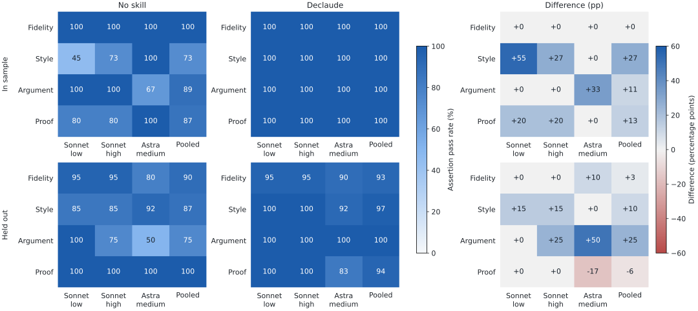

# declaude

A Claude Code and Codex skill for plain English, research exposition in the author's voice, and mathematical proofs with explicit displayed steps.

It removes rhetorical repetition and unnecessary abstractions while preserving facts, logical force, uncertainty, permissions, and scientific qualifications. It can also draft connected explanations rather than merely shorten existing text.

## Results

On eight held-out writing tasks, the selected version improved the blind grader's overall usefulness score from **4.04 to 4.54 out of 5**. Assertion passes rose from **89.1% to 95.3%**, with a case-bootstrap interval that includes no improvement. This is encouraging evidence for short editing tasks, with unresolved failures in conservative editing and proof detail.

| Split | Assertion passes, no skill → declaude | Holistic score, no skill → declaude |
|---|---:|---:|
| In sample: 8 development cases | 89.2% → 100.0% | 3.96 → 4.71 |
| Out of sample: 8 held-out cases | 89.1% → 95.3% | 4.04 → 4.54 |

The held-out differences are **+6.20 percentage points** (95% paired case-bootstrap interval **−0.83 to +12.40**) and **+0.50 holistic points** (**+0.12 to +0.79**). Development cases were used to select the skill and should not be read as an unbiased estimate of performance.

<picture>
  <source media="(prefers-color-scheme: dark)" srcset="evals/results/assertions-dark.svg">
  
</picture>

Each cell is an assertion pass percentage; the right panels show percentage-point differences. Configurations are Claude Sonnet 5.5 at low and high effort and GPT-6 Astra at medium effort. The pooled column combines the three configurations. Metric groups cover different numbers of cases and assertions; proof has only two held-out cases. Counts and grader evidence are available in the [observations](evals/results/observations.json).

### What still fails

All three configurations unnecessarily removed the local convention marker from an already-clear definition of an in-place sort. Astra also rewrote its relationship to stability ambiguously. Its variance proof retained the mathematical argument but compressed the final arithmetic that the task explicitly asked to display. Held-out proof-assertion passes consequently fell from **100% to 94.4%**.

The automatic grader's severity on the sorting example is debatable, and some fidelity assertions impose a strict reading of the task. Ratings are retained unchanged. See [failure inspection](evals/results/failure-review.md) for the actual differences and interpretation, including strict judgments about preserving supplied remarks and the wording of conditional offers.

### How it was tested

The final comparison contains **96 outputs**: 16 cases × 3 configurations × 2 conditions. An isolated Opus 5.5 high-effort grader saw anonymous responses in randomized order, with fixed assertions and a 1–5 usefulness rubric. Each case was graded in a balanced pool of six outputs. Candidate models did not see the assertions. The entire public skill and its references were inlined; private reading lists were excluded, tools were disabled, and personal global guidance was isolated from the candidate calls.

For development, four cases were used for tuning and four for validation. Three skill versions were compared on Sonnet low and Astra medium. The final revision clarified that explicit content-removal requests take precedence over general preservation rules. Both subsets became selection data. The selected version and task hashes were [frozen](evals/freeze.json) before running the held-out comparison. A separate model call authored the eight held-out cases without seeing the skill or development cases.

There were **128 candidate outputs total**, including older versions used for selection. Selection grades are published separately from the final balanced grading, since a model grader can change its verdict between calls. The skill was not revised after viewing held-out results.

These are small synthetic tasks, one response per condition, and one model grader. Bootstrap intervals reflect variation across cases, not all generation or grading uncertainty. The experiment does not establish full-paper voice fidelity, general proof correctness, automatic skill activation, or a model ranking. Length is reported descriptively and is not a success criterion. The held-out cases are now inspected and must not be reused as untouched tests for future revisions.

[Full results and selection comparisons](evals/results/report.md) · [Protocol](evals/protocol.md) · [Final observations](evals/results/observations.json) · [Selection observations](evals/results/selection-observations.json)

## Install

```sh
git clone https://github.com/hetankevin/declaude.git
cd declaude
python3 install.py
```

The installer copies `skill/` into the current user's Claude and Codex skill directories and backs up existing copies. It does not change global instructions or hooks. Invoke `/declaude` in Claude Code or `$declaude` in Codex. Normal skill discovery is enabled; this is not an always-on injection.

A private reading list can be placed in `skill/references/papers.local.md` and installed with `python3 install.py --personal`. That file is ignored by Git. The public skill works without it using the writing samples and project notes supplied with the task.

## What it does

- Removes staged candor, redundant contrasts, slogans, metaphorical process language, and dense invented compounds.
- Preserves real technical terms, distinctions, author voice, and meaningful qualifications.
- Develops research motivation before notation and mechanisms.
- Expands proof steps into readable displays with brief justifications, without altering assumptions or results.

This is an editing tool, not an AI-authorship detector or a promise to evade one.

## Reproduce

Rebuild the report and charts from published observations without making model calls:

```sh
python3 -m venv .local/venv
.local/venv/bin/pip install -r requirements.txt
.local/venv/bin/python tools/report.py \
  --observations evals/results/observations.json \
  --selection-observations evals/results/selection-observations.json \
  --cases evals/development.json evals/heldout.json \
  --selected v3 --out .local/reproduced --plot
```

With authenticated, compatible Claude and Codex CLIs, rerun the final comparison into a fresh local directory. Model calls use the accounts' available capacity:

```sh
python3 tools/bench.py run --cases evals/development.json --out .local/rerun --arms none,v3
python3 tools/bench.py run --cases evals/heldout.json --out .local/rerun --arms none,v3
python3 tools/bench.py grade --cases evals/development.json --out .local/rerun
python3 tools/bench.py grade --cases evals/heldout.json --out .local/rerun
.local/venv/bin/python tools/report.py --runs .local/rerun \
  --cases evals/development.json evals/heldout.json \
  --selected v3 --out .local/rerun-report --plot
```

The original v1 and v2 instructions are saved in `evals/versions/`. Use `--skill evals/versions/v1 --arms v1` or the corresponding v2 arguments to reproduce development comparisons. Task hashes and skill hashes prevent accidentally reusing responses from a different condition.

## Sources

The skill incorporates a user-supplied translation specification, recurring directions in research-workspace writing notes, direct author corrections about proofs and prose, and structural editing patterns from an existing humanizer skill. The public package contains generalized directions and synthetic examples; source conversations and personal workspace paths are not included. See [the translation specification](skill/references/translation.md), [research writing guidance](skill/references/paper-voice.md), and [proof guidance](skill/references/proofs.md).
